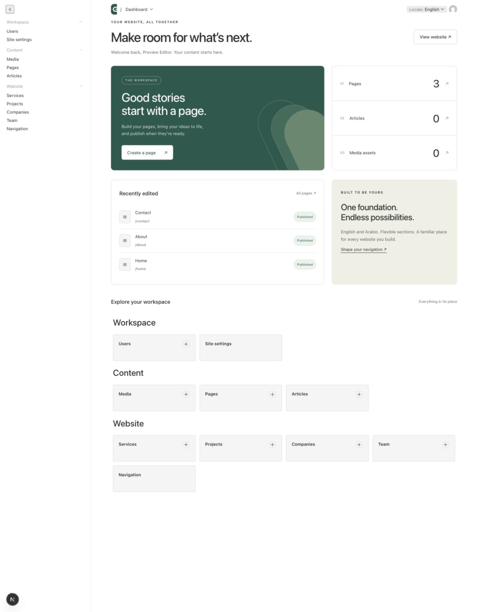

# Common CMS

A reusable, bilingual CMS foundation for business websites. Clone it for a new
client, choose the content modules, apply the brand, and keep the same editorial
workflow. Built with **Payload 3, Next.js 16, React 19, TypeScript and SQLite**.

Common provides a working admin at `/admin`, a small example website, REST and
GraphQL APIs, and an explicit place for each customization. It is a CMS, not a CRM.



## Quick start

Use **Node 22.13+** (Node 22 LTS recommended) and npm.

```bash
npm ci
npm run setup
npm run dev
```

Open **http://localhost:3000/admin** and create your first administrator. There are
no default accounts or shared passwords. Keep this first-registration step local
or behind restricted network access until you own the account.

For editable English/Arabic example pages, run in another terminal:

```bash
npm run seed
```

Then open **http://localhost:3000/en** or **http://localhost:3000/ar**. Seed content
uses fictional example copy and `example.com` addresses. It never creates users
and skips entries with existing starter slugs. Change example links before launch.

> `npm run dev` also runs setup automatically, creating a missing `.env` with a
> unique random secret. Existing configuration is preserved. The database and
> uploaded files live on disk. Nothing is stored only in browser memory.

If `PAYLOAD_SECRET must contain at least 32 characters` appears, stop the server
and restart with `npm run dev` from this directory. If `.env` already exists,
check that `PAYLOAD_SECRET` is set to a random value of at least 32 characters;
setup deliberately does not replace an existing secret. Environment variables
set by your shell or `.env.local` take precedence over `.env`. Production requires
its own configured secret; this automatic setup runs only before development.

## What is included

| Feature            | Included behavior                                                                                                     |
| ------------------ | --------------------------------------------------------------------------------------------------------------------- |
| Pages              | Reorderable hero, rich text, features, statistics, CTA and content-collection sections                                |
| Editorial workflow | Drafts, page/article autosave, authenticated previews, publish/unpublish and revision history                         |
| Media library      | JPEG, PNG, WebP, AVIF and PDF uploads; alt text; image sizes; 10 MB upload limit                                      |
| Articles           | Rich text, categories, public author name, publication date, pagination and SEO                                       |
| Business content   | Optional services, projects, companies and team collections                                                           |
| Languages          | English and Arabic content, localized inputs, RTL website and admin interface translation                             |
| Permissions        | Administrator, editor and viewer roles, enforced by the server                                                        |
| Site-wide content  | Navigation, contact details, logo, social links and SEO defaults                                                      |
| Delivery           | Working Next.js example, REST, GraphQL, metadata, sitemap and robots rules                                            |
| Repository         | Strict TypeScript, generated content types, integration tests, CI, container example, contribution guide, MIT license |

Admin interface language and content language are separate. Change the interface
language in your account preferences; choose the content locale while editing.

## Adapt it to a website

1. Edit **`src/cms.config.ts`** for the workspace name, locales and optional modules.
2. Edit **`src/collections/`** and **`src/blocks/`** for content fields.
3. Edit **`src/components/website/`** and **`website.css`** for the example frontend,
   or connect an existing frontend through the API.
4. Configure **Site settings** and **Navigation** in the admin.
5. Run `npm run generate`, create a database migration, and run the checks.

Detailed guides:

- [Customization and example website profiles](docs/CUSTOMIZATION.md)
- [Architecture and extension boundaries](docs/ARCHITECTURE.md)
- [Connect an existing website](docs/API.md)
- [Editor guide](docs/EDITOR-GUIDE.md)
- [Deployment, database migrations and backups](docs/DEPLOYMENT.md)
- [Security model](SECURITY.md)
- [Contributing](CONTRIBUTING.md)
- [Verification results and tested scope](docs/VERIFICATION.md)

This template intentionally uses **one installation per website**. Share code
through a GitHub template or an upstream repository; keep databases, secrets and
uploads separate. Shared multi-tenant hosting is not implemented.

## Commands

| Command                       | Purpose                                                                       |
| ----------------------------- | ----------------------------------------------------------------------------- |
| `npm run setup`               | Create local environment with a unique secret                                 |
| `npm run dev`                 | Start development server on localhost                                         |
| `npm run seed`                | Add starter content without replacing existing entries                        |
| `npm run generate`            | Regenerate Payload types and admin component import map                       |
| `npm run check`               | Type-check and test input validation                                          |
| `npm run format`              | Apply the shared source formatting rules                                      |
| `npm run test:integration`    | Verify access control, publishing and localization using an isolated database |
| `npm run db:create-migration` | Generate a migration after schema changes                                     |
| `npm run db:migrate`          | Apply committed migrations                                                    |
| `npm run build`               | Create the production bundle                                                  |
| `npm start`                   | Run the production server                                                     |

The generated `src/payload-types.ts`, admin `importMap.js`, migrations and
`package-lock.json` belong in source control. `.env`, SQLite databases, uploaded
media and `node_modules` do not.

## Use this as a GitHub template

Create an empty GitHub repository and push this directory:

```bash
git init
git add .
git commit -m "Create Common CMS starter"
git branch -M main
git remote add origin https://github.com/YOUR-ACCOUNT/common-cms.git
git push -u origin main
```

In the repository's **Settings → General**, enable **Template repository**.
Other developers can select **Use this template**. Retain the MIT license when
redistributing this starter; third-party packages retain their own licenses.

No GitHub repository, production hosting or existing client website is changed
by installing this local starter.

## Scope

This is a functional starter, not a finished adaptation of WBHC or Smart Details.
Their public content structures informed the optional modules; their copyrighted
copy, assets and private data are not bundled. Configure SMTP for password reset
delivery, persistent storage for hosting, and your real brand/content before launch.

Payload provides the underlying admin, authentication and content engine.
See [Payload documentation](https://payloadcms.com/docs) and
[Next.js documentation](https://nextjs.org/docs) for framework-level behavior.
